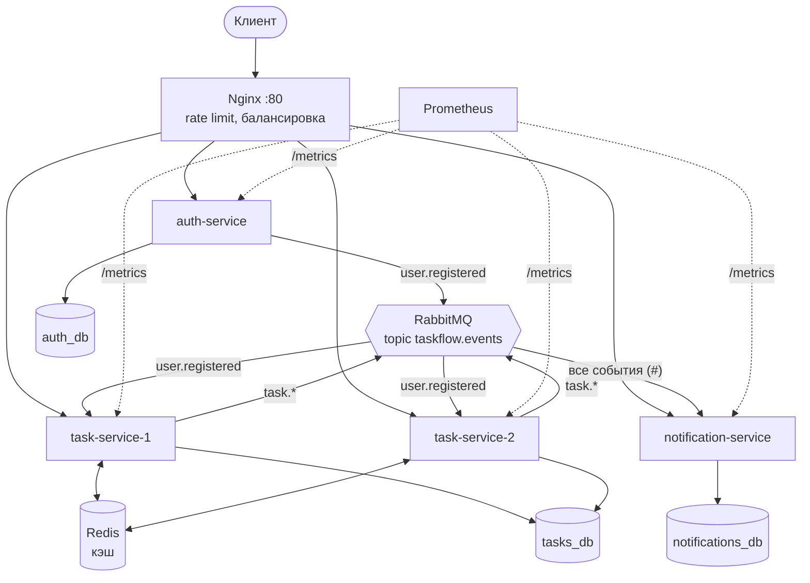

# TaskFlow

Сервис управления задачами: проекты, команды (участники проекта), задачи с исполнителями,
приоритетами и дедлайнами, асинхронные уведомления. Дипломный проект по курсу FastAPI.

Подробности об устройстве системы — в [docs/ARCHITECTURE.md](docs/ARCHITECTURE.md).

## Стек

- Python 3.13, FastAPI, Uvicorn, Pydantic v2, pydantic-settings
- PostgreSQL 16, SQLAlchemy 2 (async, `AsyncSession`), asyncpg, Alembic
- RabbitMQ 3 (aio-pika), Redis 7 (`redis.asyncio`)
- JWT (PyJWT, HS256), bcrypt
- Nginx (reverse proxy, балансировка, rate limit), Prometheus
- pytest, pytest-asyncio, httpx, fakeredis, ruff
- Docker, docker compose, GitHub Actions

## Архитектура



| Сервис | Отвечает за | БД | Публикует | Слушает |
|---|---|---|---|---|
| `auth-service` | пользователи, регистрация, логин, роли, JWT | `auth_db` | `user.registered` | — |
| `task-service` ×2 | проекты, участники, задачи, кэш | `tasks_db` | `task.created`, `task.assigned`, `task.status_changed` | `user.registered` |
| `notification-service` | уведомления пользователей | `notifications_db` | — | все события |

Три базы живут в одном контейнере PostgreSQL, но каждый сервис ходит только в свою.
JWT проверяется в каждом сервисе локально, по общему секрету. Между собой сервисы общаются
только через RabbitMQ.

## Быстрый старт

```bash
cp .env.example .env          # при необходимости поменяйте пароли и JWT_SECRET
docker compose up -d --build
docker compose ps             # через ~1 минуту все сервисы healthy, task-migrations — Exited (0)
```

Миграции применяются автоматически: auth и notification запускают `alembic upgrade head` перед стартом.
Для task-service это делает одноразовый контейнер `task-migrations`, чтобы два инстанса
не накатывали миграцию одновременно.

### Адреса

| Что | URL |
|---|---|
| API (через Nginx) | http://localhost/api/v1/... |
| Swagger auth-service | http://localhost/docs/auth |
| Swagger task-service | http://localhost/docs/tasks |
| Swagger notification-service | http://localhost/docs/notifications |
| RabbitMQ UI | http://localhost:15672 (логин/пароль — `RABBITMQ_USER` / `RABBITMQ_PASSWORD` из `.env`) |
| Prometheus | http://localhost:9090 (таргеты: http://localhost:9090/targets) |
| Health Nginx | http://localhost/health |

Порты сервисов наружу не открыты, всё идёт через Nginx. PostgreSQL проброшен на `localhost:5433`
для локальных тестов и `psql`.

### Админ по умолчанию

При первом старте auth-service создаёт администратора из `.env`:
`ADMIN_EMAIL=admin@taskflow.local`, `ADMIN_PASSWORD=Admin12345!`.

### Ручной сценарий

1. `POST /api/v1/auth/register` — зарегистрировать двух пользователей (A и B).
2. `POST /api/v1/auth/login` под A → скопировать `access_token` → кнопка **Authorize** в Swagger `/docs/tasks`.
3. `POST /api/v1/projects` — создать проект; A — владелец.
4. `POST /api/v1/projects/{id}/members` с `{"user_id": <id B>}` — добавить B в команду.
5. `POST /api/v1/projects/{id}/tasks` с `"assignee_id": <id B>` и дедлайном в прошлом.
6. Под B: `GET /api/v1/notifications` (в `/docs/notifications`) — там приветствие и уведомление о назначении.
7. Под B: `PATCH /api/v1/tasks/{id}/status` → `in_progress`; у A появится уведомление о смене статуса.
8. `GET /api/v1/projects/{id}/tasks?overdue=true` — задача в списке просроченных.

## Эндпоинты

Все пути с префиксом `/api/v1`, кроме служебных. Где написано «JWT», нужен заголовок `Authorization: Bearer <token>`.

**auth-service**

| Метод | Путь | Доступ | Описание |
|---|---|---|---|
| POST | `/auth/register` | все | регистрация → 201; дубль email → 409 |
| POST | `/auth/login` | все | `{access_token, token_type}`; неверные данные → 401 |
| GET | `/auth/me` | JWT | текущий пользователь |
| GET | `/users` | admin | список пользователей (`limit`, `offset`) |
| PATCH | `/users/{id}/role` | admin | сменить роль |

**task-service**

| Метод | Путь | Доступ | Описание |
|---|---|---|---|
| POST | `/projects` | JWT | создать проект |
| GET | `/projects` | JWT | мои проекты (admin — все), с `members_count` |
| GET | `/projects/{id}` | участник / admin | проект с участниками (кэш) |
| PATCH | `/projects/{id}` | owner / admin | изменить название и описание |
| DELETE | `/projects/{id}` | owner / admin | удалить проект |
| POST | `/projects/{id}/members` | owner / admin | добавить участника (нет в реплике → 404) |
| DELETE | `/projects/{id}/members/{user_id}` | owner / admin | удалить участника (владельца → 400) |
| POST | `/projects/{id}/tasks` | участник / admin | создать задачу (исполнитель не участник → 400) |
| GET | `/projects/{id}/tasks` | участник / admin | фильтры `status`, `assignee_id`, `overdue`, пагинация (кэш) |
| GET | `/tasks/my` | JWT | задачи, назначенные на меня |
| GET | `/tasks/{id}` | участник / admin | одна задача |
| PATCH | `/tasks/{id}` | создатель / owner / admin | изменить поля задачи и исполнителя |
| PATCH | `/tasks/{id}/status` | исполнитель / owner / admin | сменить статус |
| DELETE | `/tasks/{id}` | создатель / owner / admin | удалить задачу |

**notification-service**

| Метод | Путь | Доступ | Описание |
|---|---|---|---|
| GET | `/notifications` | JWT | мои уведомления (`unread_only`, пагинация, новые сверху) |
| PATCH | `/notifications/{id}/read` | JWT | отметить прочитанным (чужое → 404) |
| POST | `/notifications/read-all` | JWT | отметить все прочитанными |

**Служебные (в каждом сервисе):** `GET /health`, `GET /health/ready` (проверяет БД; Redis и RabbitMQ
показываются как `ok`/`degraded`), `GET /metrics` (через Nginx закрыт, 403).

Ошибки всегда приходят в формате `{"detail": "..."}`.

## События

Exchange `taskflow.events` (topic, durable). Сообщение — конверт
`{event_id, event_type, occurred_at, producer, payload}`, routing key = `event_type`.

| event_type | Кто публикует | payload | Кто обрабатывает |
|---|---|---|---|
| `user.registered` | auth | `user_id, email, full_name, role` | task-service (реплика пользователя), notification (приветствие) |
| `task.created` | tasks | `task_id, project_id, project_name, title, creator_id, assignee_id` | notification (исполнителю, если он не создатель) |
| `task.assigned` | tasks | `task_id, project_id, project_name, title, assignee_id, assigned_by` | notification (исполнителю) |
| `task.status_changed` | tasks | `…, old_status, new_status, changed_by, assignee_id, owner_id` | notification (исполнителю и владельцу, кроме автора изменения) |

Очереди: `task-service.users` (binding `user.registered`; оба инстанса — competing consumers)
и `notification-service.events` (binding `#`). Сообщения, которые не удалось обработать,
уходят через `taskflow.dlx` в очередь `taskflow.dead-letter`.

## Тесты

47 тестов: unit и integration, RabbitMQ замокан через `AsyncMock`, Redis — через `fakeredis`. Тесты
работают с настоящим PostgreSQL. Локально используется Postgres из compose (`localhost:5433`)
и базы `auth_test`, `tasks_test`, `notifications_test`: их создаёт `docker/postgres/init.sql` при первом запуске.

```bash
python3.13 -m venv .venv
.venv/bin/pip install -r auth-service/requirements-dev.txt -r task-service/requirements-dev.txt
docker compose up -d postgres

cd auth-service && ../.venv/bin/pytest -q && cd ..
cd task-service && ../.venv/bin/pytest -q && cd ..
cd notification-service && ../.venv/bin/pytest -q && cd ..
.venv/bin/ruff check .
```

Базу можно переопределить переменной `TEST_DATABASE_URL`. Если volume Postgres был создан
до появления тестовых баз, создайте их вручную:
`docker compose exec postgres psql -U taskflow -d postgres -c "CREATE DATABASE tasks_test"` (и так же для остальных).

## CI/CD

`.github/workflows/ci.yml` запускается на каждый push и pull request:

1. **lint** — `ruff check .`;
2. **test** — `pytest` для каждого сервиса (matrix) с PostgreSQL как service-контейнером;
3. **build** — только при push в `main`: собирает образы трёх сервисов и пушит в GHCR
   (`ghcr.io/<owner>/taskflow-<service>:latest`).

**Секрет:** добавьте `TEST_JWT_SECRET` в *Settings → Secrets and variables → Actions*,
значение — любая длинная случайная строка. Если секрета нет, тесты возьмут тестовое значение.

## Соответствие критериям

| Критерий | Что сделано | Где |
|---|---|---|
| Архитектура и код | 3 микросервиса на FastAPI, REST, Pydantic, слои routes → services → models/database | `*/app/` |
| БД и миграции | PostgreSQL, AsyncSession, 4 модели со связями, Alembic, 4 индекса, защита от N+1 (`selectinload`, `members_count` подзапросом) | `task-service/app/models`, `*/migrations/`, `task-service/tests/test_n_plus_one.py` |
| RabbitMQ | topic exchange, 4 типа событий, 2 consumer'а, DLQ, идемпотентная обработка | `*/app/messaging.py`, `*/app/consumer.py` |
| Docker | 3 Dockerfile, compose, `.env`, healthcheck, volumes, `depends_on` с condition | `docker-compose.yml`, `*/Dockerfile` |
| Redis | 2 кэшируемых эндпоинта, инвалидация через версию-ключ, graceful degradation | `task-service/app/cache.py`, `task-service/tests/test_cache.py` |
| Nginx | reverse proxy, 2 инстанса task-service (`least_conn`), rate limit, `X-Request-ID` | `nginx/nginx.conf` |
| CI/CD | GitHub Actions: ruff, pytest на push, сборка образов, Secrets | `.github/workflows/ci.yml` |
| Мониторинг | `/metrics` во всех сервисах, 8 кастомных метрик, `/health` и `/health/ready` | `*/app/metrics.py`, `prometheus/prometheus.yml` |
| Тесты | 47 тестов: unit и integration, моки, фикстуры | `*/tests/` |
| Документация | README, архитектура, Swagger с summary и кодами ошибок | `README.md`, `docs/ARCHITECTURE.md` |
