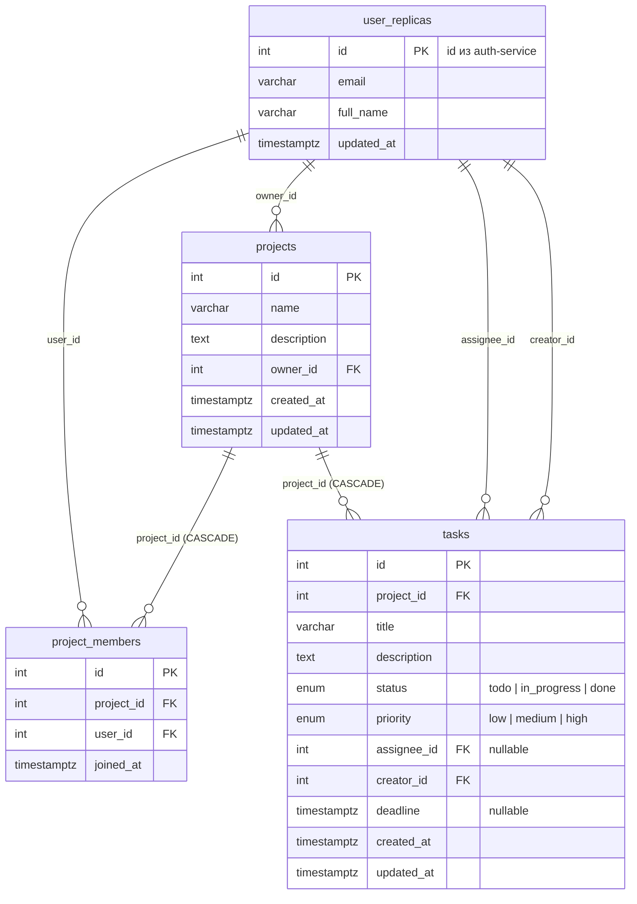
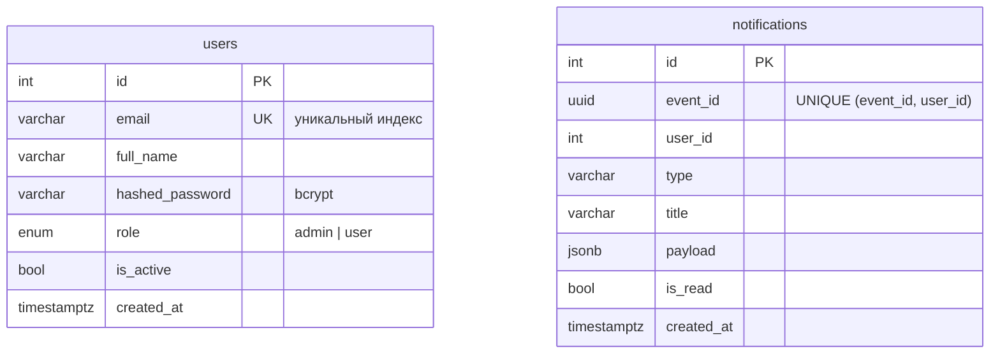
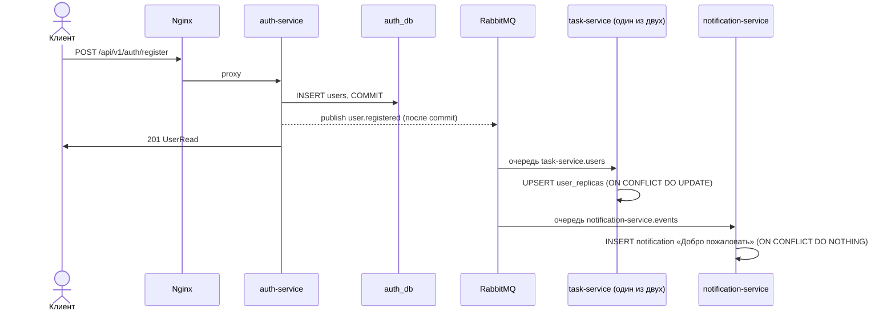
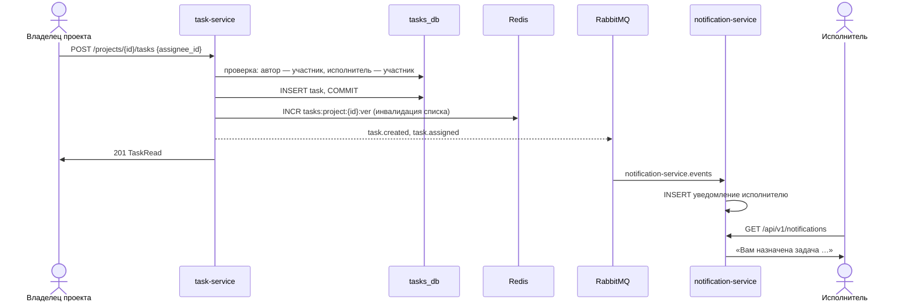

# Архитектура TaskFlow

## Сервисы и ответственность

| Сервис | Ответственность | Хранилище |
|---|---|---|
| **auth-service** | Регистрация, логин, роли `admin`/`user`, выпуск JWT, админ по умолчанию. Публикует `user.registered`. | `auth_db` |
| **task-service** (2 инстанса) | Проекты, участники (команда), задачи, правила доступа, фильтры. Кэширует чтение в Redis. Публикует `task.*`, слушает `user.registered`. | `tasks_db`, Redis |
| **notification-service** | Превращает события в уведомления пользователям, отдаёт их по API. Слушает все события. | `notifications_db` |
| **Nginx** | Единая точка входа, балансировка task-service, rate limit, `X-Request-ID`. | — |
| **Prometheus** | Собирает `/metrics` со всех сервисов. | volume |

Внутри каждого сервиса один и тот же набор слоёв:

```
routes/       тонкие роуты: валидация (Pydantic), зависимости, вызов сервиса
services/     бизнес-логика и права доступа; публикация событий и работа с кэшем
models/       SQLAlchemy-модели
database.py   engine, async_sessionmaker, get_session
```

## Схема БД

### tasks_db (task-service)



Индексы:
- `ix_tasks_project_status (project_id, status)` — список задач проекта с фильтром по статусу;
- `ix_tasks_assignee_id` — «мои задачи»;
- `ix_tasks_deadline` — просроченные задачи;
- `uq_project_members (project_id, user_id)` — человек состоит в проекте не больше одного раза.

### auth_db и notifications_db



У `notifications` есть индекс `ix_notifications_user_is_read (user_id, is_read)`.

## Потоки событий

### Регистрация → реплика пользователя



### Назначение задачи → уведомление



### Надёжность обработки

- Событие публикуется **только после успешного `commit()`**. Если брокер недоступен, ошибка
  пишется в лог и в метрику `events_published_total{result="error"}`, а запрос пользователя
  всё равно выполняется.
- Consumer подтверждает сообщение после обработки (`message.process(requeue=False)`).
  Если обработчик бросил исключение, сообщение отклоняется и через DLX `taskflow.dlx` попадает
  в очередь `taskflow.dead-letter`. Сломанное сообщение не крутится в бесконечном цикле.
- Обработка идемпотентна. Реплика обновляется через upsert, уведомления защищены
  уникальным ключом `(event_id, user_id)`. Повторная доставка того же события не создаёт дублей.

## Стратегия кэша

Кэшируются два чтения в task-service:

| Эндпоинт | Ключ | Инвалидация |
|---|---|---|
| `GET /projects/{id}` | `project:{id}` | `DEL` при изменении проекта, добавлении или удалении участника, удалении проекта |
| `GET /projects/{id}/tasks` | `tasks:project:{id}:v{ver}:{md5(параметры)}` | `INCR tasks:project:{id}:ver` при создании, изменении, удалении задачи или смене статуса, а также при удалении участника или проекта |

- **Права проверяются до чтения кэша.** В кэше лежат данные, а не решение о доступе,
  поэтому посторонний пользователь получит 403 даже при горячем кэше.
- TTL — `CACHE_TTL_SECONDS` (по умолчанию 60 с).
- **Graceful degradation.** Клиент Redis создаётся с таймаутами 0.5 с. Любая ошибка Redis
  (`RedisError`, `OSError`) считается промахом: запрос идёт в БД, а в лог пишется предупреждение.
  `/health/ready` в этом случае показывает `redis: degraded`, но отвечает 200.
- Метрика `cache_requests_total{result="hit|miss|error"}`.

## Обоснование решений

**Database per service.** У каждого сервиса своя база, в чужие сервисы не ходят. Схемы меняются
независимо, сервисы не связаны через таблицы, и любой сервис можно вынести на отдельный сервер БД.
Ради простоты запуска все три базы живут в одном контейнере PostgreSQL.

**Локальная проверка JWT.** auth-service подписывает токен секретом `JWT_SECRET` (HS256),
а остальные сервисы проверяют подпись тем же секретом. Синхронного вызова auth-service на каждый
запрос нет, поэтому падение auth-service не ломает работу с задачами по уже выданным токенам.
Цена этого подхода: роль в токене актуальна до истечения его срока (`JWT_EXPIRE_MINUTES`).

**Реплика пользователей в task-service.** Таблица `user_replicas` наполняется событием
`user.registered`. Она нужна, чтобы:
- проверить, что добавляемый участник существует (404), не спрашивая auth-service;
- вернуть имя исполнителя одним `selectinload`, без N+1 и без межсервисных запросов;
- держать внешние ключи `owner_id`, `assignee_id` и `creator_id` внутри своей базы.

Если событие ещё не дошло, а пользователь уже создаёт проект, сервис добавляет заглушку из данных
токена (`ON CONFLICT DO NOTHING`). Пришедшее позже событие обновит имя.

**Версия-ключ для инвалидации списков.** У списка задач много вариантов ключа: фильтры
и пагинация. Удалять их через `SCAN`/`KEYS` дорого и небезопасно под нагрузкой. Вместо этого
версия проекта входит в ключ, а `INCR` версии делает все старые ключи недостижимыми;
они удаляются сами по TTL. Инвалидация занимает одну атомарную операцию.

**Отдельный сервис миграций.** Два инстанса task-service не должны одновременно запускать
`alembic upgrade head`: они начнут гоняться за одну миграцию. Поэтому миграции применяет
одноразовый контейнер `task-migrations`. Инстансы стартуют только после его успешного
завершения (`depends_on: condition: service_completed_successfully`).

**Балансировка и наблюдаемость.** Nginx распределяет запросы по двум инстансам (`least_conn`)
и перерезолвит их адреса через DNS Docker, так что пересоздание контейнера не ломает прокси.
Nginx проставляет `X-Request-ID`, сервисы пишут его в каждую строку лога и возвращают в ответе.
task-service добавляет `X-Instance-ID`, чтобы было видно, какой инстанс ответил.

## Метрики

| Метрика | Сервис |
|---|---|
| `auth_registrations_total` | auth |
| `auth_logins_total{result}` | auth |
| `tasks_created_total` | tasks |
| `task_status_changes_total{from_status, to_status}` | tasks |
| `cache_requests_total{result}` | tasks |
| `events_published_total{event_type, result}` | auth, tasks |
| `events_consumed_total{event_type, result}` | tasks, notifications |
| `notifications_created_total{type}` | notifications |

Кроме них, есть стандартные HTTP-метрики (`prometheus-fastapi-instrumentator`): количество запросов
и латентность по хендлерам.
